

  

<h1 align="center">Zeus</h1>

<strong>WhatsApp, native and fast.</strong> A lightweight desktop WhatsApp client for Windows, macOS, and Linux.

  <a href="https://github.com/ItIsNotKeshav/zapfast/releases/latest"><strong>Download</strong></a> ·
  <a href="#install">Install</a> ·
  <a href="#link-your-phone">Link your phone</a> ·
  <a href="#credits">Credits</a>

  
  
  

Zeus is a fork of [ZapFast](https://github.com/crmne/zapfast) by
[Carmine Paolino](https://github.com/crmne). It is a native WhatsApp app
written in Rust with [egui](https://www.egui.rs), with no browser engine
inside. It links to your phone as a companion device, the way WhatsApp Web
does, and keeps your chats in an encrypted archive on your own computer.

  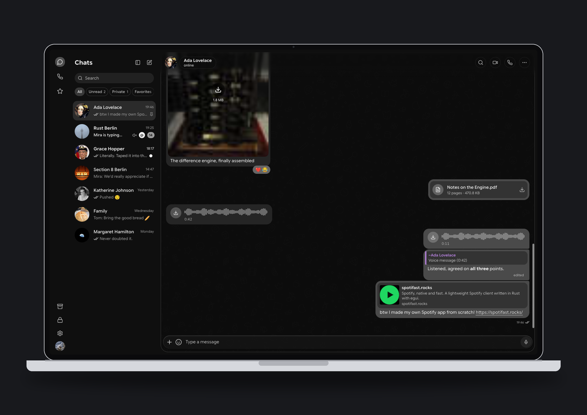

<em>The screenshots use made-up demo chats, never real conversations.</em>

## Your look

20 ready-made themes, each in light and dark, or your own mix of look, mode
and accent. Frosted panels with blur you can switch off, and doodle wallpapers
in several styles.

  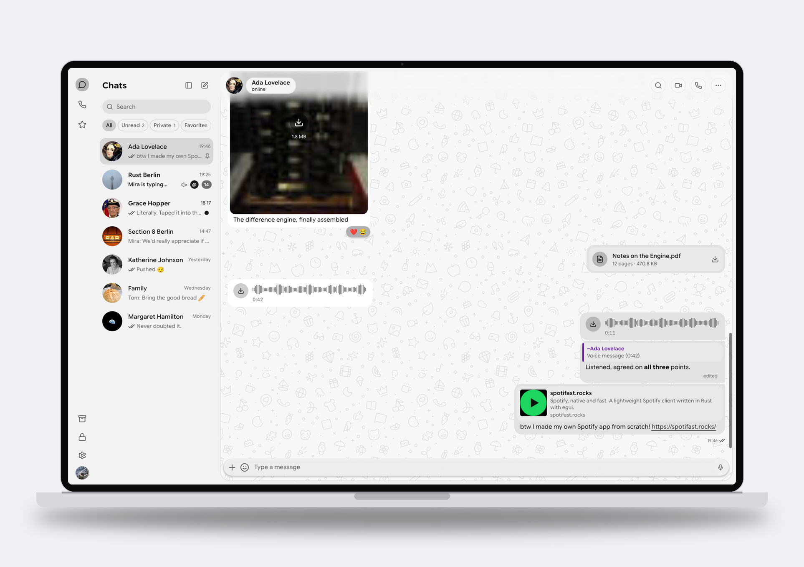
  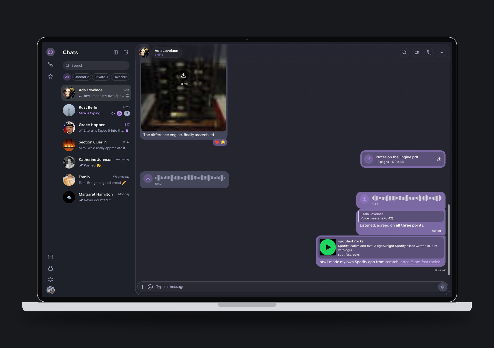

  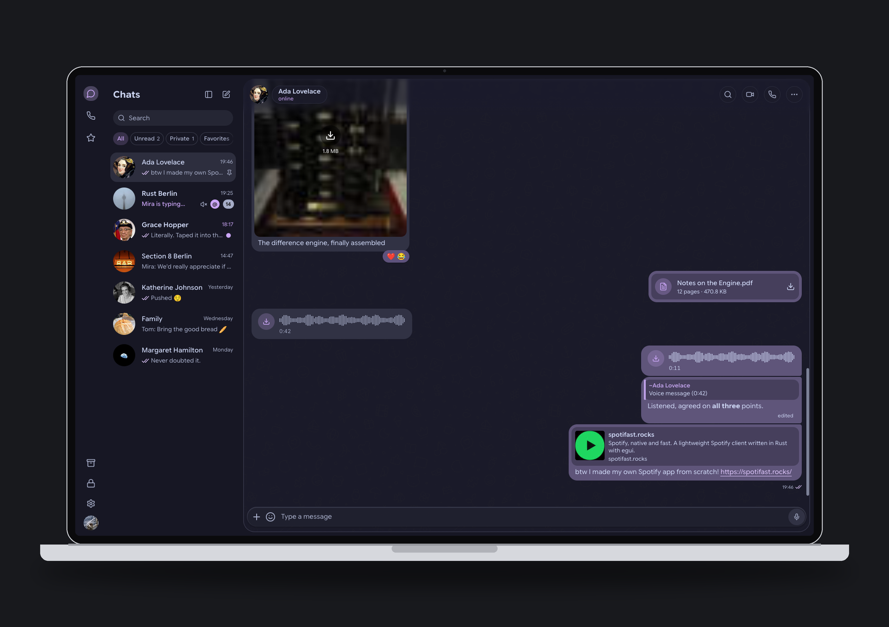
  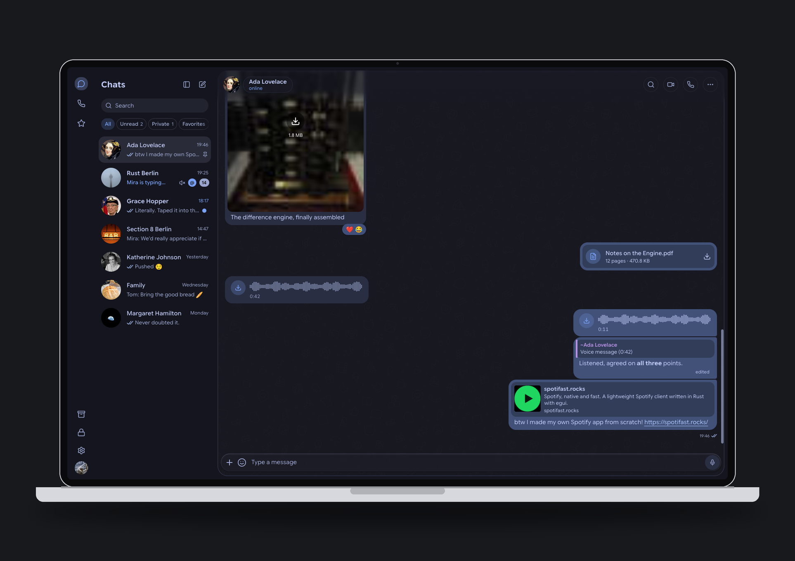

  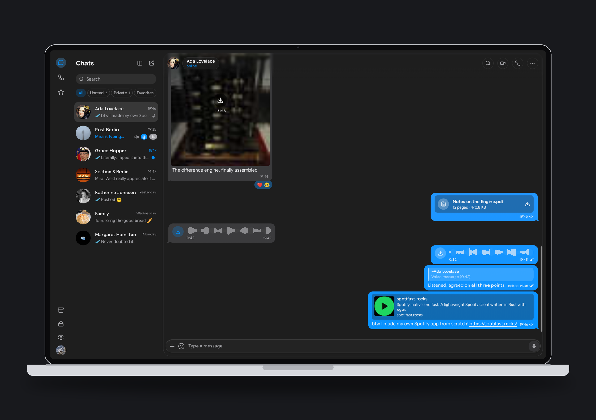
  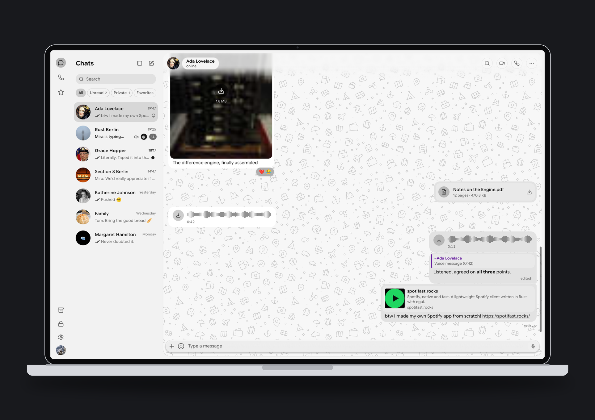

## Chats that feel good

Frosted composer, attachment previews while files send, reactions you can pick
from the message, and a message menu with Reply, Edit, Forward, Pin and more.

  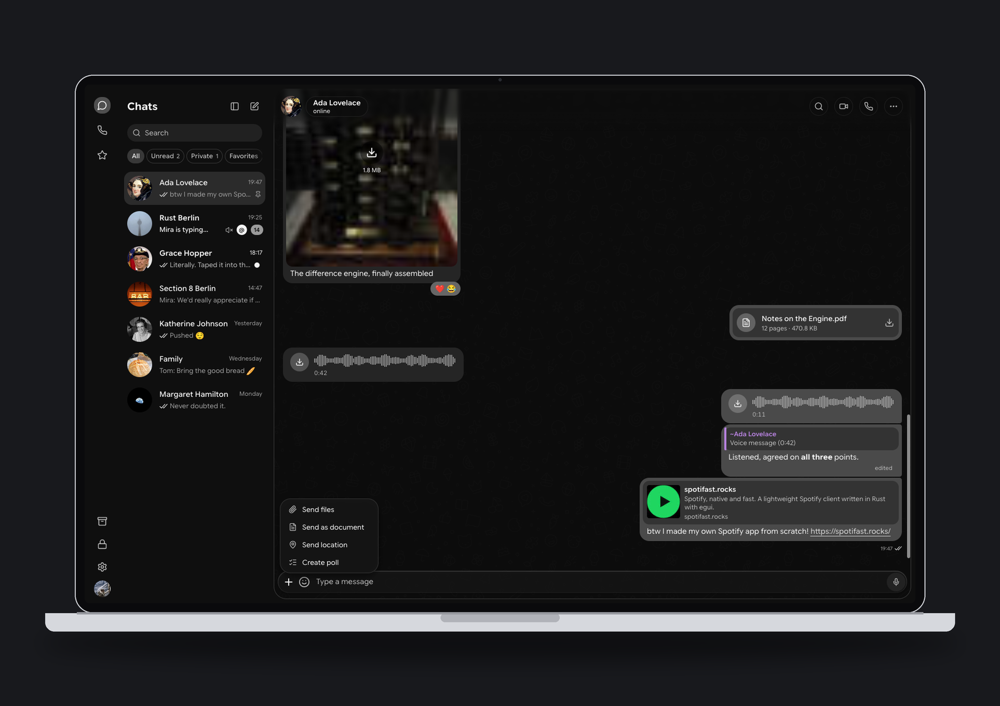
  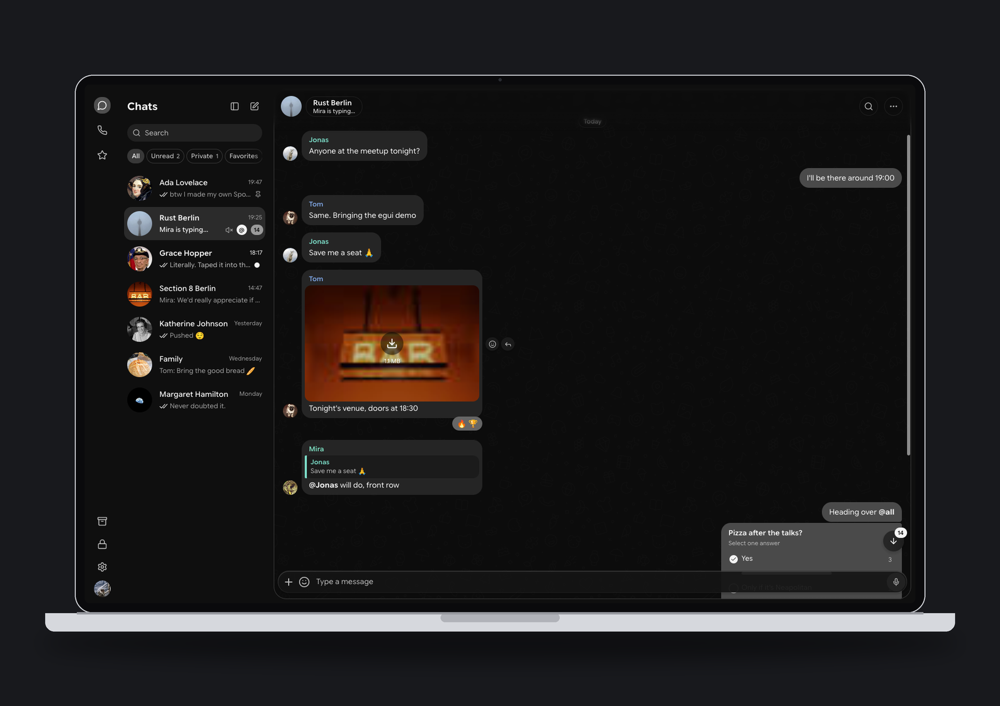

## Settings

A sidebar of categories with search. Appearance, Chats, Notifications, Calls
and voice (pick your microphone, push to talk), Privacy, and more.

  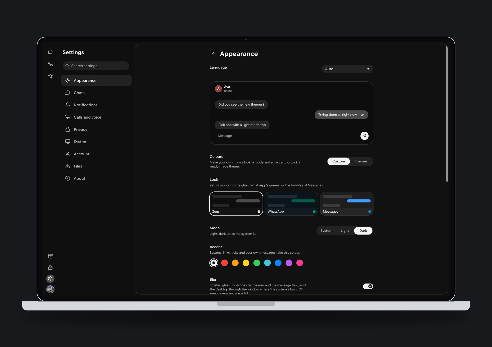
  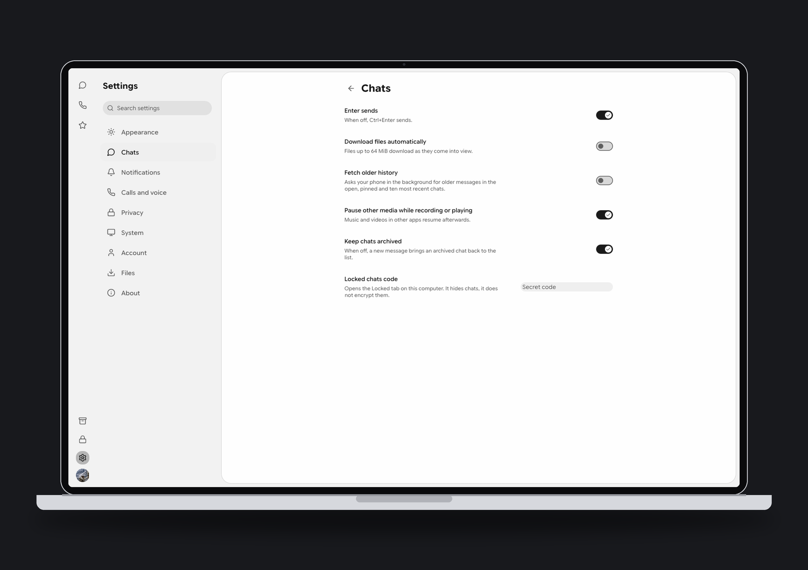

  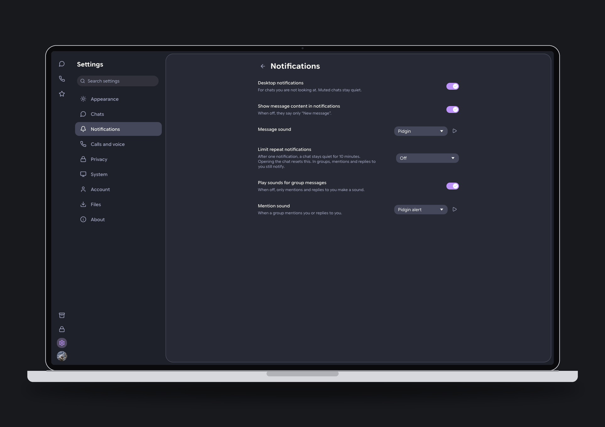
  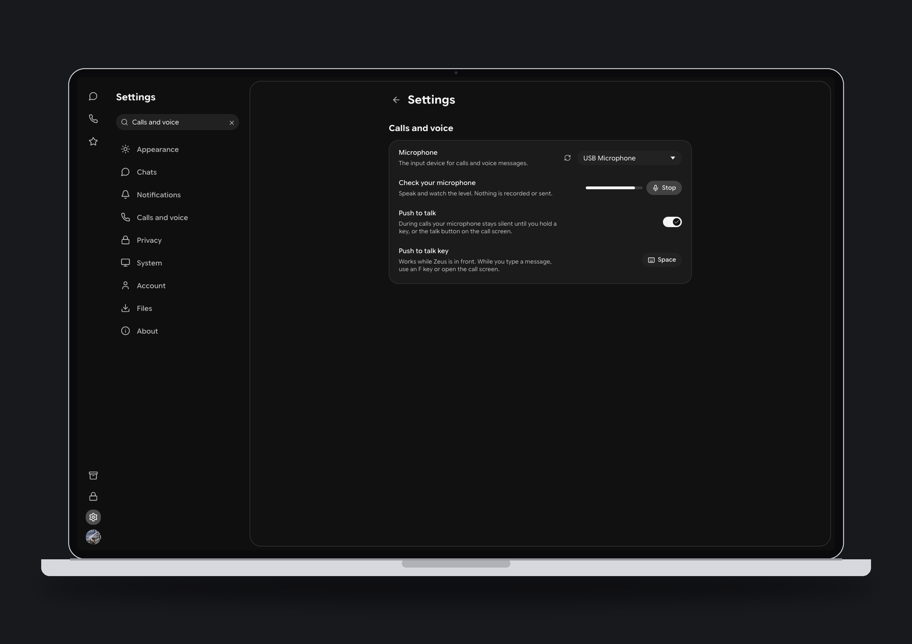

## What Zeus is

Zeus is ZapFast, tuned for everyday use. It already ships ZapFast's new voice
and video calls, and adds its own touches on top:

- **Better calls.** Pick your microphone once in Settings, and hold a key to
  talk when the room is noisy.
- **Your colours.** 20 ready-made themes, each in light and dark, or your own
  mix of look, mode and accent. Frosted bars, with blur you can switch off.
- **Clearer chats.** Photos and files show a preview and progress while they
  send, times can stay on every message, and sent messages fly in from the
  composer.
- **Beside ZapFast, not over it.** Its own Windows installer, folders,
  settings and linked devices, so both can run.

Everything else comes from ZapFast: formatting, replies, edits, reactions,
media, stickers, GIFs, polls, voice messages, several numbers in one window,
locked chats, an app lock, and tray notifications, in ten languages.

## Install

| Platform | How |
|---|---|
| **Windows** | Download `zeus-v<version>-x86_64-pc-windows-msvc-setup.exe` from [Releases](https://github.com/ItIsNotKeshav/zapfast/releases/latest). It installs for your user without administrator rights and updates itself from then on. It is not code-signed, so Windows SmartScreen warns once: choose **More info**, then **Run anyway**. |
| **macOS** | Download the `.tar.gz` for your Mac (Apple Silicon is `aarch64`, Intel is `x86_64`) and run the `zeus` binary. There is no `.app` bundle yet, and the binary is unsigned. |
| **Linux** | Download the `.tar.gz`, unpack it, and run `zeus`. It includes a desktop entry and icon you can copy into place. |
| **From source** | Install Rust, then run `cargo build --release --locked`. Linux needs ALSA, PipeWire, and clang headers, and every platform needs cmake. |

Only the Windows build is tested by the maintainer. The macOS and Linux builds
are produced by GitHub Actions and are not yet tried on real machines, so
please report what you find.

## Link your phone

1. Open Zeus. It shows a QR code.
2. On your phone, open WhatsApp, go to **Linked devices**, and choose **Link a device**.
3. Scan the code. Your recent chats appear, and Zeus asks your phone for older history as you scroll.

Zeus is a companion device, so your phone remains the main account. Your chats
stay in an encrypted archive on this computer, and nothing goes to a server
of ours.

## Guides

Zeus shares ZapFast's behaviour, so the
[ZapFast guides](https://zapfast.rocks/) apply: how linking works, settings
and stored files, shortcuts, and making your own theme. Their screenshots show
ZapFast's name and colours.

## Credits

Zeus exists because of [ZapFast](https://github.com/crmne/zapfast), created
and maintained by **Carmine Paolino** ([@crmne](https://github.com/crmne)) and
its [contributors](https://github.com/crmne/zapfast/graphs/contributors).
The app, its design, and almost all of its code are their work. Please
[star and support the original project](https://github.com/crmne/zapfast).

Zeus also builds on:

- [whatsapp-rust](https://github.com/oxidezap/whatsapp-rust) for the WhatsApp protocol
- [egui](https://www.egui.rs) and [fastframe](https://fastframe.dev) for the interface and desktop integration
- the open-source libraries listed in [THIRD-PARTY-NOTICES.md](THIRD-PARTY-NOTICES.md)

## Disclaimer

Zeus is an unofficial client. It is not affiliated with, endorsed by, or
connected to WhatsApp or Meta. Use it at your own risk: WhatsApp can limit
accounts that use unofficial clients.

## License

MIT. Copyright (c) 2026 Carmine Paolino, and Keshav for the changes in this
fork. See [LICENSE](LICENSE).
